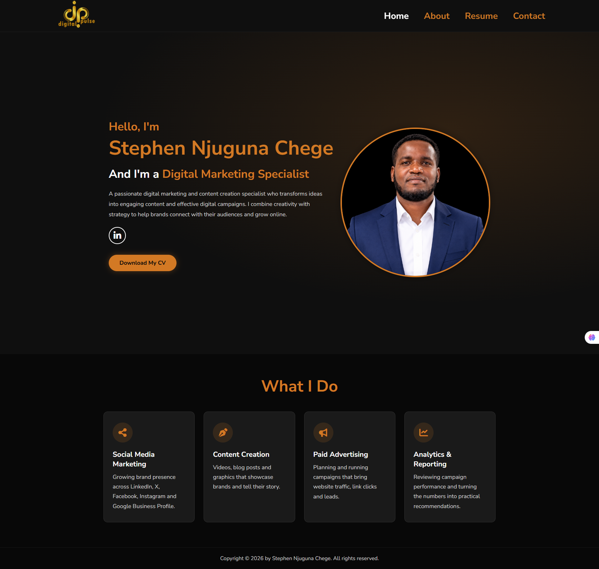
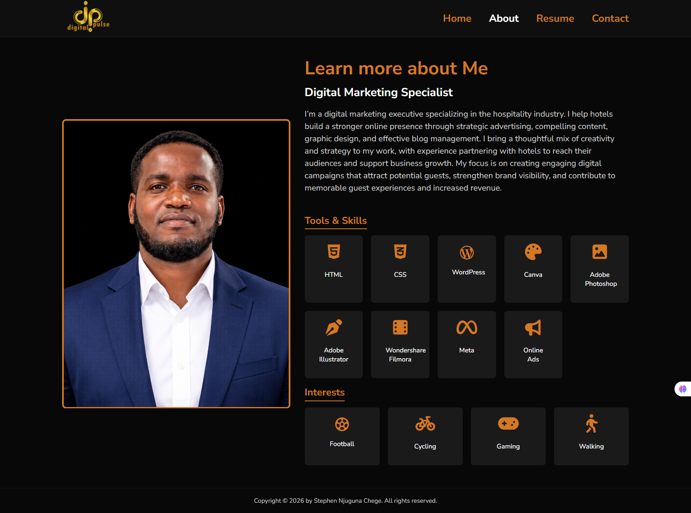
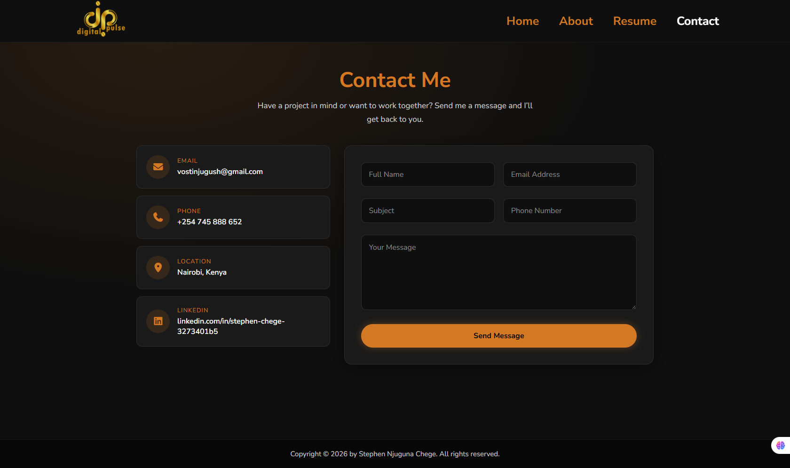
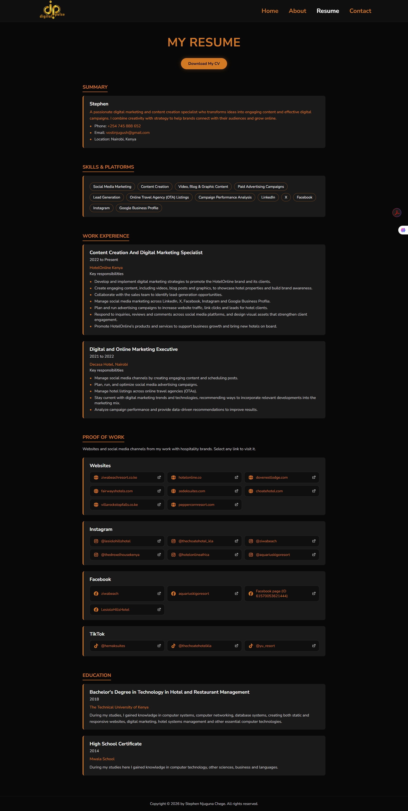

<div align="center">

# Stephen Njuguna Chege | Portfolio Website

**A fast, responsive, dark-themed portfolio for a digital marketing and content creation specialist.**

[](#tech-stack)
[](#tech-stack)
[](#tech-stack)
[](#deployment)

[**View the live site**](https://YOUR-SITE.vercel.app) · [Report a problem](../../issues)

<br />



</div>

---

## Table of contents

- [About the project](#about-the-project)
- [Features](#features)
- [Screenshots](#screenshots)
- [Tools & Skills](#tools-&-Skills)
- [Project structure](#project-structure)
- [Quick start](#quick-start)
- [Manual: how to update the site](#manual-how-to-update-the-site)
- [Contact form setup](#contact-form-setup)
- [Deployment](#deployment)
- [Pre-launch checklist](#pre-launch-checklist)
- [Troubleshooting](#troubleshooting)
- [Roadmap](#roadmap)
- [Credits and licence](#credits-and-licence)
- [Author](#author)

---

## About the project

This is a four-page portfolio website built for **Stephen Njuguna Chege**, a digital marketing and content creation specialist working in the hospitality industry. It presents his services, experience and tools, links to the websites and social media channels he manages, and lets potential clients contact him directly.

It is a **client project** designed and developed by [Lubano Mabisi Dennis](#author). The goal was a site that loads quickly, looks polished on both phones and desktops, and is simple enough for a non-developer to maintain, so it uses plain HTML, CSS and JavaScript with no build step.

## Features

- **Four pages:** Home, About, Resume and Contact.
- **Fully responsive:** layouts adapt from large monitors to small phones, with a mobile menu on narrow screens.
- **Dark theme with an orange accent:** every colour comes from a handful of CSS variables, so the whole palette can be changed in one place.
- **Proof of Work section:** 21 clickable links to client websites and Instagram, Facebook and TikTok channels, grouped by platform.
- **Downloadable CV** from the Home and Resume pages.
- **Working contact form** that sends messages straight to an email inbox, with:
  - friendly validation messages under each field
  - a hidden spam trap (honeypot)
  - protection against double submissions
  - a native form fallback if JavaScript fails to load
- **Motion with care:** scroll-reveal animations and a typing effect are switched off automatically for visitors who ask their device to reduce motion.
- **Accessibility basics:** one `h1` per page, logical heading order, labelled form fields, keyboard-friendly menu, visible focus outlines and descriptive alt text.
- **Search and sharing basics:** page titles, descriptions, favicon and link-preview tags on every page.

## Screenshots

<table>
  <tr>
    <td width="50%"><b>Home</b><br /></td>
    <td width="50%"><b>About</b><br /></td>
  </tr>
  <tr>
    <td colspan="2"><b>Contact</b><br /></td>
  </tr>
</table>

<details>
<summary><b>Resume page (full length)</b></summary>
<br />



</details>

## Tools & Skills

| Area         | Used                                                                                                          |
| ------------ | ------------------------------------------------------------------------------------------------------------- |
| Markup       | HTML5 (semantic elements)                                                                                     |
| Styling      | CSS3 (custom properties, Grid, Flexbox, media queries)                                                        |
| Behaviour    | Vanilla JavaScript (no framework)                                                                             |
| Icons        | [Font Awesome 7](https://fontawesome.com/) and [Remix Icon](https://remixicon.com/)                           |
| Font         | [Nunito Sans](https://fonts.google.com/specimen/Nunito+Sans) (Google Fonts)                                   |
| Animation    | [ScrollReveal 4.0.9](https://scrollrevealjs.org/) and [Typed.js 2.1.0](https://github.com/mattboldt/typed.js) |
| Contact form | [FormSubmit](https://formsubmit.co/) (email delivery without a server)                                        |
| Hosting      | [Vercel](https://vercel.com/)                                                                                 |

## Project structure

```text
.
├── index.html          # Home page
├── about.html          # About page: bio, tools and skills, interests
├── resume.html         # Resume page: experience, education, proof of work
├── contact.html        # Contact page with the message form
├── style.css           # All styling, including the colour variables
├── style.js            # Menu, animations, typing effect and contact form logic
├── assets/             # Images and documents used by the pages
│   ├── logo.png        #   site logo (top-left of every page)
│   ├── steve.png       #   profile photo (Home and About)
│   └── Stephen-CV.pdf  #   CV offered by the "Download My CV" buttons
├── docs/
│   └── screenshots/    # Images used in this README
└── README.md
```

> **Note:** file and folder names are case-sensitive on the live server. `assets/Steve.png` and `assets/steve.png` are different files there, even though Windows treats them as the same. Keep names lowercase (except `Stephen-CV.pdf`, which must match exactly) and avoid spaces.

## Quick start

You only need a web browser to view the site, and no installation is required.

**Option A: open the file**

1. Download or clone the repository.
2. Double-click `index.html`.

**Option B: run a local server** (closest to the live site)

```bash
# from inside the project folder
python3 -m http.server 8000
```

Then open <http://localhost:8000>.

**Option C: VS Code**

Install the _Live Server_ extension, right-click `index.html` and choose **Open with Live Server**.

> The contact form is best tested on the deployed site. Browsers and form services can treat pages opened straight from a folder differently.

## Manual: how to update the site

Every change below is a small edit in one or two files. After editing, commit and push the changes, and Vercel republishes the site automatically (see [Deployment](#deployment)).

### Change the name or any text

Text lives directly in the HTML files. In your editor, use **Find in files** (`Ctrl+Shift+F` in VS Code) to search for a word such as `Stephen` and update every page. The name appears in each page's `<title>`, in the footer and in the Home page heading.

### Replace the photo, logo or CV

1. Save the new file inside the `assets/` folder using **exactly the same name** as the old one (`steve.png`, `logo.png` or `Stephen-CV.pdf`), replacing it.
2. Keep images small. Aim for under 300 KB for the photo and under 100 KB for the logo.
3. If you use a different file type or name, update the matching `src` or `href` in the HTML files.

> Use a logo with a transparent background that is readable on a dark bar. The header is nearly black.

### Change the colours or fonts

Open `style.css`. The palette is defined once at the top:

```css
:root {
  --bg-color: #0f0f0f; /* main page background */
  --bg-alt-color: #080808; /* darker sections and footer */
  --card-color: #1a1a1a; /* cards and boxes */
  --accent-color: #d37924; /* the orange */
  --light-color: #fff; /* headings and highlights */
  --muted-color: #ccc; /* paragraph text */
  --header-height: 9rem; /* height of the fixed top bar */
}
```

Change a value and the whole site follows. To change the font, replace the Google Fonts link in the `<head>` of each page and the `font-family` in the `body` rule.

### Add a tool or skill (About page)

In `about.html`, copy one `skill-box` inside the Tools and Skills grid and change the icon and the name:

```html
<div class="skill-box">
  <i class="fa-solid fa-film" aria-hidden="true"></i>
  <h3>Tool name</h3>
</div>
```

Icon names come from the [Font Awesome icon list](https://fontawesome.com/icons). Choose free icons, and check on the live site that the icon displays.

### Add a Proof of Work link (Resume page)

In `resume.html`, copy one `work-link` inside the right group (Websites, Instagram, Facebook or TikTok):

```html
<a
  class="work-link"
  href="https://example.com/"
  target="_blank"
  rel="noopener noreferrer"
>
  <i class="fa-solid fa-globe" aria-hidden="true"></i>
  <span>example.com</span>
  <i
    class="fa-solid fa-arrow-up-right-from-square work-link-arrow"
    aria-hidden="true"
  ></i>
  <span class="sr-only">(opens in a new tab)</span>
</a>
```

Always keep `target="_blank"` together with `rel="noopener noreferrer"`. For social links, use the clean profile address without tracking text such as `?utm_source=...`.

### Update experience, education or summary

Edit the matching `resume-item` block in `resume.html`. Each job or degree is one `resume-item`, and each responsibility is one `<li>`.

## Contact form setup

The form sends messages by email through **FormSubmit**, so no server is needed.

**The email address appears in five places.** Change all of them together when the inbox changes:

| File           | Where                                                                  |
| -------------- | ---------------------------------------------------------------------- |
| `style.js`     | `FORM_ENDPOINT` at the top of the file, and the fallback error message |
| `contact.html` | the form's `action`, and the visible Email card                        |
| `resume.html`  | the Email link in the Summary card                                     |

**First-time activation (required):**

1. Deploy the site and send one test message from the Contact page.
2. FormSubmit emails an **activation link** to the receiving inbox. Check spam and promotions.
3. Click the link. After that, every message arrives in the inbox as a tidy table.

**If you change the receiving email**, repeat the activation for the new address.

> Good to know: the email address is visible in the site's source code, as with any form that works without a server. For heavier traffic, consider a form service with built-in spam filtering or a small serverless function.

## Deployment

The site is a static website, so there is no build step.

**Vercel with GitHub (recommended)**

1. Push the project to GitHub.
2. On [vercel.com](https://vercel.com/), choose **Add New, then Project**, and import the repository.
3. Leave the framework as **Other**, with no build command and the output left at the project root.
4. Click **Deploy**.

From then on, every push to the `main` branch publishes automatically. Open the **Deployments** tab and wait for **Ready**, then refresh the site with `Ctrl+Shift+R`.

**Custom domain:** in the Vercel project, open **Settings, then Domains** and follow the instructions.

## Pre-launch checklist

Run through this before sharing the site with anyone:

- [ ] Photo, logo and CV are in `assets/` with the correct names, and the photo is compressed
- [ ] Photo and logo display on every page
- [ ] Both **Download My CV** buttons open the PDF
- [ ] Every link on the Resume and Contact pages opens the right place
- [ ] The FormSubmit activation email has been clicked
- [ ] A test message reaches the correct inbox
- [ ] Every page checked on a real phone and in a second browser
- [ ] The email, phone number and links shown on the site are the client's final ones
- [ ] The repository contains no passwords, keys or private files

## Troubleshooting

| Problem                                 | Likely cause and fix                                                                                                                                   |
| --------------------------------------- | ------------------------------------------------------------------------------------------------------------------------------------------------------ |
| Images do not show on the live site     | The file name or folder spelling differs in capitals. Names are case-sensitive on the server. Open `your-site/assets/steve.png` directly to test.      |
| Old image still showing after an update | The browser kept a stored copy. Hard-refresh with `Ctrl+Shift+R`, or open the site in a private window.                                                |
| Image or CV works on my PC but not live | The file was not committed and pushed. Check that it appears in the repository on GitHub, then wait for the new deployment to say **Ready**.           |
| The form shows "could not be sent"      | Make sure the FormSubmit activation link was clicked. Open the browser console (`F12`, then **Console**), send again and read the message shown there. |
| An icon is blank                        | The icon name is not in the loaded Font Awesome version. Try another icon from the free set.                                                           |
| Changes do not appear online            | Confirm that the commit was pushed to `main` and that Vercel shows a new **Ready** deployment.                                                         |

## Roadmap

Ideas for future versions:

- [ ] Custom domain and a share-preview image for WhatsApp and LinkedIn
- [ ] Case studies with screenshots and measurable results for the strongest campaigns
- [ ] Client testimonials
- [ ] A short video reel or gallery of content work
- [ ] Analytics and a short privacy notice
- [ ] Image optimization (WebP) and self-hosted libraries for faster loading
- [ ] Sitemap and structured data for search engines
- [ ] Automatic reply to people who use the contact form
- [ ] Simple content editing for the client without touching code

## Credits and licence

- Icons: [Font Awesome](https://fontawesome.com/) and [Remix Icon](https://remixicon.com/)
- Font: [Nunito Sans](https://fonts.google.com/specimen/Nunito+Sans) by Google Fonts
- Libraries: [ScrollReveal](https://scrollrevealjs.org/) and [Typed.js](https://github.com/mattboldt/typed.js)

&copy; 2026 Stephen Njuguna Chege. Website design and development by Lubano Mabisi Dennis. The photo, logo, CV, text and links belong to Stephen Njuguna Chege and may not be reused without permission. All rights reserved unless otherwise agreed.

## Author

**Lubano Mabisi Dennis**, Nairobi, Kenya

Designed, built and deployed this website for the client.

- GitHub: [Lubano254](https://github.com/Lubano254)
- LinkedIn: [linkedin.com/in/lubano-dennis-57a5a5392]

Questions or ideas? Open an [issue](../../issues).
